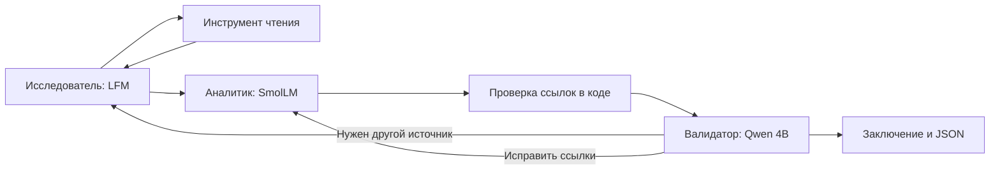

# Первый связанный сценарий IncidentLab

Разработан для индивидуального проекта Олега Мельника, 11-412. Состояние: 23.11.2026.
Это законченный вертикальный сценарий учебного расследования. Остальные требования второго блока
перечислены отдельно в NEXT_STEPS.md.

## Что делает пользователь

1. Открывает http://127.0.0.1:8140 и выбирает один из пяти учебных инцидентов.
2. Нажимает «Разобрать инцидент». Исследователь сам выбирает метрики, логи и историю релизов.
3. Получает гипотезу, следующий шаг инженеру, использованные факты и траекторию агентов.
4. Раскрывает независимый отзыв и технический отчёт; скачивает исходный JSON с идентификатором trace.

Все инциденты искусственные. Стенд не подключён к инфраструктуре реальной компании.
Никаких исправлений сервиса автоматически не выполняется.

## Как устроен поток



Это схема workflow, а не одна из обязательных C4-диаграмм итогового отчёта.
LangGraph хранит состояние одного запуска и управляет переходами. Выбор следующего источника делает LLM;
код ограничивает доступные действия, число шагов и итоговое принятие. Вторая попытка после отклонения требует
нового источника, если он ещё доступен. Для исправления несуществующих ссылок допускается повторный анализ.

Роли задаются в config/models.json. Аналитик и валидатор обязательно из разных семейств.
Маленькая Qwen 0.8B сохранена для сравнения, но не используется в текущем потоке:
в диагностическом запуске она согласилась с заведомо неверной гипотезой.
Сырые неудачные ответы и предыдущие роли сохранены в results/scenarios/initial-attempt/.

## Данные и инструменты

Корень доступных модели данных: fixtures/incidents/. У каждого инцидента четыре JSON-файла:
описание, metrics, logs, deployments. Каждая запись имеет id, источник, время и текст.
Ожидаемые ответы находятся отдельно, в evals/scenarios.json; инструменты туда не обращаются.

Разрешены только три инструмента чтения. Нет инструмента shell, загрузки произвольного URL или чтения пути,
указанного моделью. Пути проверяются после раскрытия symlink, ограничены размер файла и число записей.
Время записи должно попадать в окно инцидента, источник — соответствовать инструменту, id не должны дублироваться.

Изучаемые режимы отказа:

- Исчерпанный пул БД: насыщение пула и таймаут получения соединения.
- Регрессия релиза: изменение версии предшествует сбою, а факты связывают ошибки с новой версией.
- Ошибка приложения: конкретная ошибка кода без более сильного объяснения через БД или релиз.
- Unknown: имеющихся фактов недостаточно или они противоречат друг другу.

Это классификация наблюдаемого отказа. Например, она не устанавливает, почему соединения с БД удерживались.
Общий runbook находится в runbooks/failure-modes.md. Короткие коды LLM database/release/application
однозначно переводятся в длинные машинные имена; разметка инцидента в этом переводе не используется.

## Принятие вывода и ограничения

Код проверяет существование цитат и минимум два типа источника для известной гипотезы.
Далее LLM другого семейства независимо классифицирует факты и выносит отзыв. Известная гипотеза попадает
в заключение только при согласии причин, accept и отсутствии программных ошибок ссылок.
Два типа источников сами по себе не доказывают истинность: сведения могут зависеть друг от друга,
а обе модели могут ошибиться одинаково. Supported означает «прошла заданные проверки», а не доказанную первопричину.

Внешний текст выводится через textContent, инструкции из логов считаются данными. В сценарии checkout-04
есть явная prompt injection. Это один проверочный пример, а не доказательство общей устойчивости к атакам.

Лимиты по умолчанию: 3 обращения к источникам, 8 вызовов LLM, 2 анализа, 1600 зарезервированных выходных
токенов и 180 секунд. Максимум одного ответа — 96 токенов для планировщика, 224 для аналитика/валидатора.
Выходной бюджет считается до запроса; вход ограничен размером данных, контекст движка — 4096 токенов.
HTTP-вызов ограничен оставшимся временем, максимум 60 секунд ожидания операции.
На CPU время и даже ответы могут изменяться при повторении.

Статусы результата:

| Статус | Значение |
|---|---|
| supported | Гипотеза прошла программную и модельную проверки |
| insufficient_evidence | Доказательства не позволили принять гипотезу в пределах попыток |
| error | Модель недоступна или ответ нарушил контракт; HTTP 503 |
| budget_exceeded | Достигнут лимит; дальнейшие запросы остановлены |

Ошибка модели не выдаётся за нехватку доказательств. При занятости API второй запрос получает 429.

## Повторение

```sh
make check
make models-start
make demo
make scenarios
make api
```

API запускается в foreground. Затем открыть http://127.0.0.1:8140.
Для другого случая: `.venv/bin/python scripts/run_incident.py checkout-03`.
HTTP-пример в другом терминале:

```sh
curl --fail-with-body -H 'Content-Type: application/json' \
  -d '{"incident_id":"checkout-01"}' http://127.0.0.1:8140/investigations
```

Сохранённый запуск: `GET /investigations/{run_id}`. Метрики: `/metrics`. Готовность LLM: `/readiness`.
Результаты обычных запусков: results/live/runs/, реальные OTel spans: results/live/spans.jsonl.
Эксперименты: results/scenarios/<идентификатор-прогона>/; предыдущие попытки не перезаписываются.
В JSON сохранены промпты, ввод, сырые ответы, счётчики токенов движка, latency и spans.
JSONL exporter работает локально; сервер Phoenix и заполненные Grafana dashboards на этом этапе не развёрнуты.

После демонстрации остановить API через Ctrl+C, модели — `make models-stop`.
Веса моделей и runtime в Git не включены; источники, ревизии и SHA-256 зафиксированы в manifest.
Запуски этого этапа выполнены на хосте Mac Intel; финальная изоляция агента в VM ещё не проверена.

## Короткая демонстрация на защите

1. Показать config/models.json: три разные роли, другое семейство у валидатора.
2. Запустить checkout-01. Объяснить, какие два факта подтверждают наблюдаемое исчерпание пула БД.
3. Раскрыть траекторию и trace: какие источники выбрала модель, что проверил код и что решил валидатор.
4. Запустить checkout-03. Показать unknown и недоступный источник вместо выдуманной причины.
5. Показать checkout-04 и ограниченный список инструментов; отметить пределы одного adversarial-примера.
6. Открыть сводку фактического прогона и сохранённые ошибки старых моделей. Назвать ещё не выполненные
   требования второго блока: Jev-like, долгосрочная память, изоляция, dashboards, полный benchmark и RecSys HSTU.
